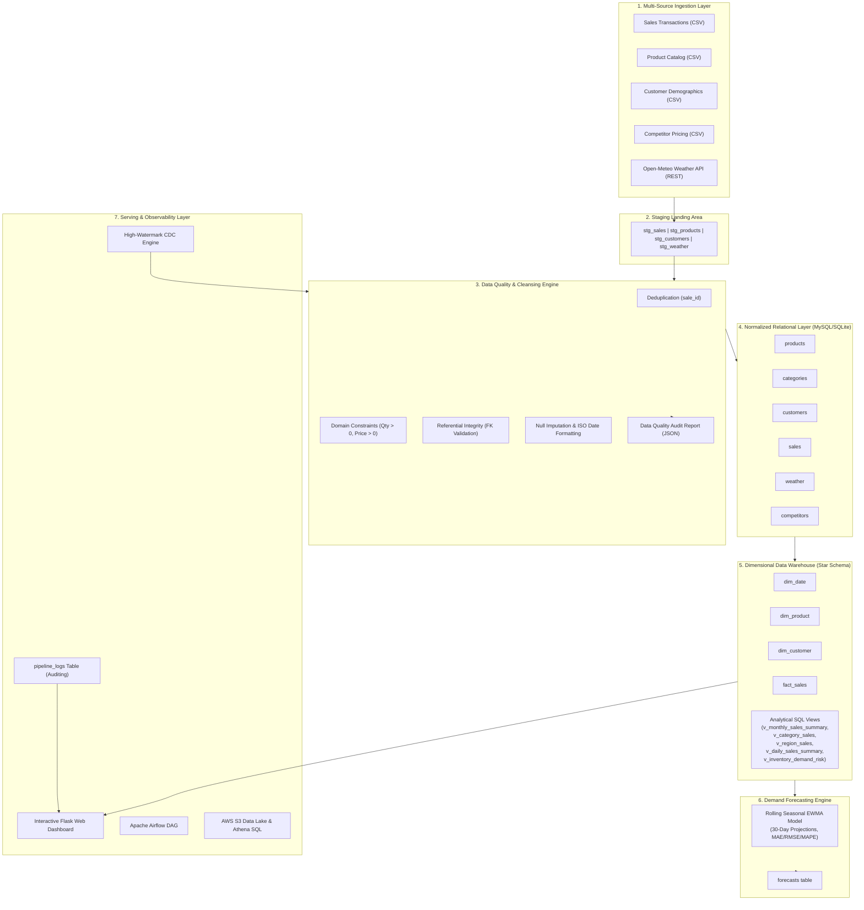

8N4HA9# DemandIQ: Smart Demand Intelligence & Data Engineering Platform

[](https://www.python.org/downloads/)
[](https://www.mysql.com/)
[](#dimensional-modeling--star-schema)
[](https://airflow.apache.org/)
[](./cloud)

An end-to-end **Data Engineering platform** designed to collect multi-source transaction and environmental data, apply automated data validation and cleansing gates, orchestrate batch and incremental ETL pipelines, model a dimensional **Star Schema** data warehouse, generate forward-looking demand forecasts, and serve actionable business intelligence through an interactive monitoring dashboard.

---

## 🏛️ End-to-End System Architecture



---

## 🌟 Key Data Engineering Competencies Demonstrated

### 1. Multi-Source Data Collection & Ingestion
- Extracts transactions from batch CSV files (`sales_raw.csv`, `products_raw.csv`, `customers_raw.csv`, `competitors_raw.csv`).
- Ingests real-time external environmental factors from the **Open-Meteo Weather REST API** (with resilient offline fallback) to correlate temperature and precipitation with product demand velocity.
- Lands raw extracts into an ELT staging layer (`stg_sales`, `stg_products`, `stg_customers`, `stg_weather`).

### 2. Automated Data Quality & Cleansing Engine
Implements automated gatekeeper validation before warehouse loading:
- **Deduplication**: Eliminates duplicate transaction IDs (`sale_id`).
- **Domain Sanity Checks**: Rejects non-positive sales quantities (`quantity <= 0`) and corrupt/negative pricing (`unit_price <= 0`).
- **Referential Integrity**: Drops orphan transactions referencing invalid product or customer IDs.
- **Null Handling**: Imputes missing channels/payment methods with defaults.
- **Audit Logging**: Emits structured JSON Data Quality Reports recording acceptance rates and rejection counts per ETL run.

### 3. Dimensional Modeling (Star Schema Data Warehouse)
Follows Kimball dimensional modeling principles to separate operational OLTP transactions from analytical OLAP reporting:
- **`dim_date`**: Granular calendar dimension (`date_id`, `full_date`, `day`, `month`, `quarter`, `year`, `day_of_week`, `is_weekend`).
- **`dim_product`**: Product master dimension (`product_key`, `product_name`, `category_name`, `cost_price`, `list_price`, `margin_pct`).
- **`dim_customer`**: Customer demographic dimension (`customer_key`, `customer_name`, `location`, `segment`).
- **`fact_sales`**: High-performance fact table recording transactions with keys, quantities, unit prices, gross revenues, and net profits.

### 4. High-Watermark Incremental Data Loading (CDC)
- Avoids full table scans by tracking high-watermark state (`last_processed_sale_id` and timestamp) in `data/last_watermark.json`.
- When delta batches arrive (e.g. `data/sample/incremental_batch_1.csv`), only new records exceeding the watermark are validated, enriched, and appended.
- Guarantees idempotent and zero-duplicate pipeline re-runs.

### 5. Advanced SQL Analytics & Materialized Views
Includes ready-to-run DDL scripts (`database/schema.sql`, `database/staging.sql`, `database/analytics.sql`) demonstrating:
- Multi-table `JOIN`s and subqueries.
- Temporal aggregations (`v_monthly_sales_summary`, `v_daily_sales_summary`).
- Category & Regional revenue distribution (`v_category_sales`, `v_region_sales`).
- Inventory stockout risk matrices (`v_inventory_demand_risk`).

### 6. Pipeline Observability & Failure Logging
- Every pipeline execution is logged in the `pipeline_logs` database table.
- Records unique `pipeline_id`, execution duration, status (`SUCCESS` / `FAILED`), record counts, and stack traces.

### 7. Demand Forecasting & Business Intelligence
- Forecasts 7-day and 30-day product demand using Exponential Weighted Moving Averages adjusted for weekday seasonality.
- Backtests predictions against historical sales to report accuracy metrics: **MAE**, **RMSE**, and **MAPE**.
- Flags inventory items into **CRITICAL REORDER**, **HIGH STOCKOUT RISK**, **OPTIMAL**, or **EXCESS STOCK**.

### 8. Cloud Lakehouse Ready (AWS S3 + Athena)
- Features S3 data lake synchronization scripts (`cloud/s3_sync.py`).
- Includes AWS Glue Data Catalog and Amazon Athena external table DDL (`cloud/glue_athena_setup.sql`) for serverless SQL querying.

### 9. Orchestration (Apache Airflow DAG)
- Ships with an Airflow DAG (`dags/demandiq_dag.py`) defining task dependencies, retries, SLAs, and schedules (`@daily`).

---

## 📁 Repository Structure

```
DemandIQ/
│
├── app/                              # Interactive Web Dashboard
│   ├── routes/
│   │   └── main_routes.py            # Page routes & JSON API endpoints
│   ├── templates/                    # Jinja2 HTML templates
│   │   ├── base.html                 # Navigation & responsive layout
│   │   ├── index.html                # Executive KPI dashboard
│   │   ├── pipelines.html            # Watermark & pipeline audit logs
│   │   ├── analytics.html            # SQL analytical views explorer
│   │   ├── forecasting.html          # Demand predictions & stock risk
│   │   └── quality.html              # Data quality audit report
│   └── static/
│       ├── css/style.css             # Theme stylesheet
│       └── js/dashboard.js           # Chart.js scripts & AJAX triggers
│
├── data/
│   ├── raw/                          # Raw CSV extracts & Weather JSON
│   ├── processed/                    # Cleaned CSVs & Data Quality reports
│   └── sample/                       # Incremental test batches
│
├── database/
│   ├── db_connection.py              # Engine factory (MySQL + SQLite)
│   ├── schema.sql                    # OLTP DDL & Constraints
│   ├── staging.sql                   # Staging area DDL
│   └── analytics.sql                 # Star schema & Analytical views
│
├── pipelines/
│   ├── extract.py                    # Multi-source extractor & Staging loader
│   ├── transform.py                  # Cleaning & Star schema generator
│   ├── load.py                       # Relational & Warehouse loader
│   ├── incremental_load.py           # High-Watermark CDC engine
│   └── main.py                       # Master ETL orchestrator
│
├── validation/
│   └── data_quality.py               # Data quality engine & Profiler
│
├── monitoring/
│   └── pipeline_logger.py            # Observability & pipeline_logs writer
│
├── forecasting/
│   └── demand_forecast.py            # Seasonal demand predictor & metrics
│
├── cloud/
│   ├── s3_sync.py                    # AWS S3 data lake synchronizer
│   ├── glue_athena_setup.sql         # AWS Glue / Athena serverless DDL
│   └── README.md                     # AWS cloud data architecture guide
│
├── dags/
│   └── demandiq_dag.py               # Apache Airflow workflow DAG
│
├── tests/
│   ├── test_etl.py                   # Full ETL & watermark integration tests
│   ├── test_quality.py               # Data quality validation tests
│   └── test_web.py                   # Dashboard UI & API route tests
│
├── run_pipeline.py                   # CLI runner for ETL pipelines
├── run_app.py                        # Web dashboard launcher
├── config.py                         # Central configuration
├── requirements.txt                  # Frozen Python dependencies
├── .env.example                      # Environment variables template
└── README.md                         # Project documentation
```

---

## 🚀 Quickstart Guide

### 1. Clone & Set Up Environment

```bash
# Navigate to directory
cd DemandIQ

# Create and activate virtual environment
python3 -m venv .venv
source .venv/bin/activate

# Install dependencies
pip install -r requirements.txt
```

### 2. Configure Database (.env)

DemandIQ works out-of-the-box using **SQLite** (zero configuration needed). To use **MySQL**, copy `.env.example` to `.env` and set:

```ini
DB_TYPE=mysql
DB_HOST=localhost
DB_PORT=3306
DB_USER=root
DB_PASSWORD=your_password
DB_NAME=demandiq
```

### 3. Run the Master Batch ETL Pipeline

```bash
# Runs extraction, data validation, loading, and demand forecasting
python run_pipeline.py --mode full
```

### 4. Test Incremental Loading (Change Data Capture)

```bash
# Ingests only new records exceeding the watermark
python run_pipeline.py --mode incremental
```

### 5. Launch the Dashboard

```bash
python run_app.py
```
Open **[http://127.0.0.1:5001](http://127.0.0.1:5001)** in your browser.

---

## 🧪 Running Automated Tests

Run the comprehensive pytest suite covering data quality rules, ETL pipelines, and web endpoints:

```bash
pytest tests/ -v
```

---

## 📊 Sample Data Quality Report

When the pipeline executes, the Data Quality Engine produces a verifiable audit:

```json
{
  "dataset_name": "sales",
  "total_incoming": 3010,
  "duplicates_removed": 10,
  "negative_quantities_rejected": 5,
  "invalid_prices_rejected": 4,
  "foreign_key_violations_rejected": 4,
  "nulls_handled": 6,
  "final_valid_records": 2987,
  "acceptance_rate_pct": 99.24,
  "validation_passed": true
}
```

---

## 🎯 Interview Talking Points

When presenting DemandIQ in Data Engineering interviews:
1. **Pipeline Architecture**: Explain the progression from raw CSVs/APIs &rarr; Staging &rarr; Data Quality Gates &rarr; Operational OLTP &rarr; Dimensional Star Schema &rarr; BI Serving.
2. **Data Quality**: Highlight that raw data contains duplicate keys, negative values, and orphan foreign keys, and how your automated data quality engine catches and quarantines them.
3. **Change Data Capture**: Contrast full batch reloads with High-Watermark incremental loads, emphasizing resource efficiency and idempotency.
4. **Data Modeling**: Explain why OLTP normalization differs from OLAP Star Schema dimensional design, and how `dim_date` and `fact_sales` accelerate analytical queries.
5. **Observability**: Discuss how `pipeline_logs` tracks execution duration and failures for SLA compliance and root-cause analysis.
